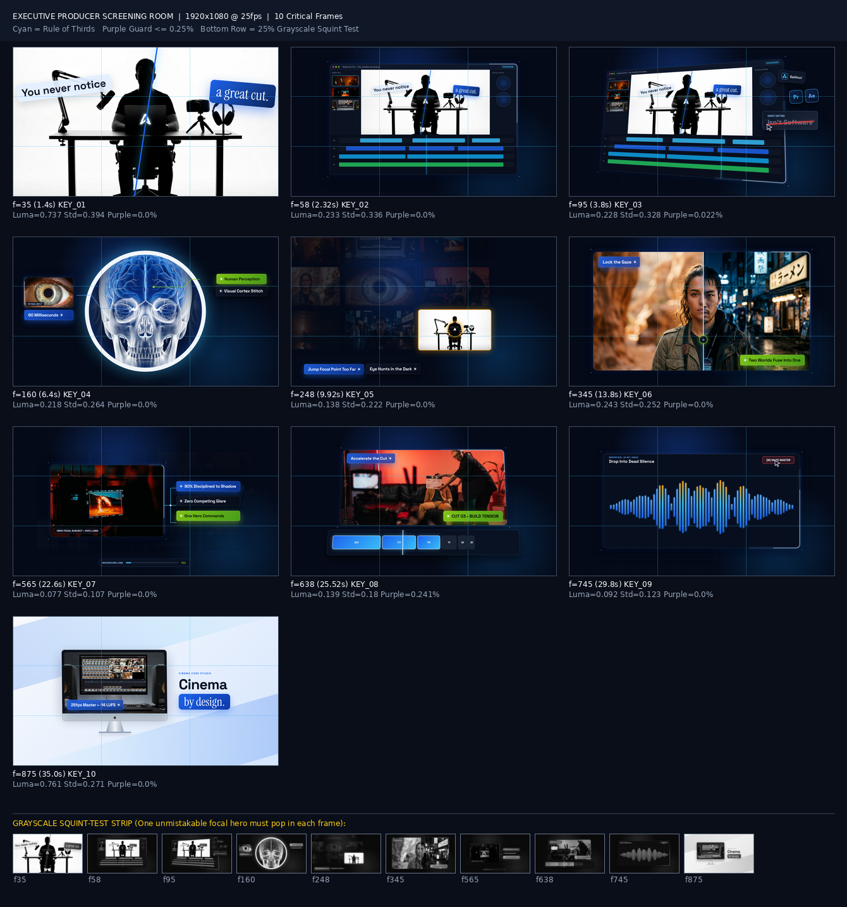
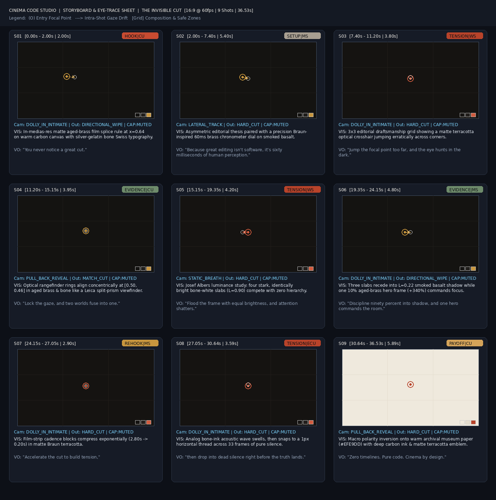

# Cinema Code Studio (v4.0 — Commercial Mixed-Media & Analog Post House)

A full-craft programmatic video editing, mixed-media compositing, cinematography, motion graphics, OKLCH color scripting, and EBU R128 psychoacoustic mastering **Agent Skill** built on **Remotion 4.0.538 + React 19 + FFmpeg + Whisper/Python** — zero GUI timelines required.



---

## What's New in v4.0 (`COMMERCIAL_MIXED_MEDIA` Architecture)

- **Modernized Remotion 4.0.538 + React 19 Engine**: Preloaded `@remotion/google-fonts` (`Space Grotesk` + `Instrument Serif`) preventing headless Linux font fallbacks, `@remotion/motion-blur`, `@remotion/paths`, `@remotion/shapes`, and single-bundle batch still rendering in `qa_screening_room.py` (~10× faster QA).
- **Gate 4 Mixed-Media Asset Sourcing & Visual Verification (`verify_mixed_media_assets.py`)**: Replaces abstract geometric CSS/3D shapes and AI-slop stock generation with **5–8 literal mixed-media layers per shot**—fetching authentic vector brand/software SVGs (`React`, `TypeScript`, `FFmpeg`, `DaVinci`, `GitHub`, `Apple`) and real topic photography first, then verifying resolution, zero artifacts, and `0%` purple/neon contamination before compositing.
- **Commercial Mixed-Media Primitives (`src/commercial/CommercialPrimitives.tsx`)**:
  - `PortalZoomStage` — Recursive "World-Inside-World" speed-ramp zoom-outs (`25 fps`) with velocity-proportional Gaussian blur and 3D perspective tilts.
  - `GlowSweepFrame` — Animated perimeter corner light-sweep viewports with architectural `+` reticles.
  - `GlassNodeCard` & `OrthogonalNodeTree` — Frosted-glass callout hierarchies (`cobalt` / `dark` / `lime` / `white`) connected via orthogonal SVG circuit spines.
  - `SplitMatchViewport` — Pupil- and nose-bridge-calibrated (`transformOrigin: "50% 37%"`) split-portrait match-cut stage.
  - `StudioCursor` — Tactile commercial vector pointer with spring click-bounce and ripple ring.
  - `BokehRingWipe` & `CobaltStudioBackdrop` — Foreground blurred studio ring-light lens transitions and high-contrast sapphire (`#040A18`) / daylight cyclorama (`#F8FAFC`) environments.
- **Dual Zero-Purple / Zero-Neon Studio Color Profiles (`validate_color_script.py`)**:
  - `commercial_cobalt` — Deep cinema sapphire (`#040A18`), electric cobalt (`#1D63ED`), studio daylight (`#F8FAFC`), and tactile indicator lime (`#84CC16`).
  - `analog_editorial` — Warm matte carbon (`#141311`), archival silver-gelatin bone (`#EFE9DD`), aged Kodak brass (`#C8963E`), and Braun terracotta (`#C84B31`).
  - **Both profiles mathematically forbid all purple/violet/magenta (`275°–350°`) and raw neon lasers (`maxPurplePct <= 0.25%`).**

---

## The 10-Gate Deterministic Studio Pipeline

1. **Gate 1 — Creative Direction & Visual World** (`01_creative_brief.json`)
2. **Gate 2 — Media & Retention Intelligence** (`probe_and_normalize.py`, `transcribe_and_diarize.py`, `analyze_audio_energy.py`, `auto_reframe_eyes.py`)
3. **Gate 3 — Perceptual OKLCH Color Script** (`validate_color_script.py` — `commercial_cobalt` or `analog_editorial`)
4. **Gate 4 — Mixed-Media Asset Sourcing & Visual Verification** (`verify_mixed_media_assets.py` + mandatory visual inspection)
5. **Gate 5 — Storyboard & Walter Murch Eye-Trace Continuity** (`audit_eye_trace.py`, `render_storyboard_board.py`)
6. **Gate 6 — Master Frame-Accurate Paper Cut** (`audit_retention_and_pacing.py`)
7. **Gate 7 — Commercial Mixed-Media & Camera Choreography** (`CommercialPrimitives.tsx`, continuous virtual camera motivation, zero parked objects)
8. **Gate 8 — Psychoacoustic Sound Design** (`synth_studio_sfx.py` — microswitch clicks, optical ring-wipe whooshes, `-∞ dB` pre-payoff silence drops)
9. **Gate 9 — Executive Producer Visual QA Screening Room** (`qa_screening_room.py` — batch keyframes, grayscale squint strip, automated HSV purple guard)
10. **Gate 10 — Broadcast Master Render** (`master_mix_and_render.py` — H.264 CRF 17 + two-pass `-14.0 LUFS / -1.0 dBTP` loudness normalization)



---

## Repository Structure

```text
├── cinema-code-studio/                 # Complete Agent Skill source (v4.0.0)
│   ├── SKILL.md                        # Orchestrator, 10-Gate Pipeline & 12 Non-Negotiable Laws
│   ├── references/                     # 9 deep craft & engineering manuals
│   ├── scripts/                        # 13 Python validators, asset auditors, renderers & mixers
│   └── assets/
│       ├── remotion-studio/            # Remotion 4.0.538 + React 19 starter & CommercialPrimitives.tsx
│       ├── audio-kit/                  # 48kHz broadcast Foley/SFX kit
│       ├── schemas/                    # JSON Schemas for brief, storyboard & timeline
│       └── examples/                   # Validated OKLCH & storyboard reference JSONs
├── cinema-code-studio.skill            # Packaged installable .skill archive
└── examples/
    └── the-invisible-cut/              # Flagship 1080p25 Commercial Mixed-Media film ("The Invisible Cut")
        ├── preprod/                    # Brief, color script, storyboard & v4 QA screening sheet
        └── remotion/                   # 9-World mixed-media choreography + verified SVG/photo assets
```

---

## Quickstart

### 1. Scaffold a New Commercial Production
```bash
python3 cinema-code-studio/scripts/init_production.py ./my-commercial --fps 25 --width 1920 --height 1080
```

### 2. Verify Mixed-Media Assets & Color Script
```bash
python3 cinema-code-studio/scripts/validate_color_script.py examples/the-invisible-cut/preprod/03_color_script.json
python3 cinema-code-studio/scripts/verify_mixed_media_assets.py \
  examples/the-invisible-cut/remotion/public/assets \
  --out-sheet examples/the-invisible-cut/preprod/asset-sheet.jpg
```

### 3. Screen Critical Frames & Render Master
```bash
cd examples/the-invisible-cut/remotion
npm install
npm run typecheck
npm run render
```
